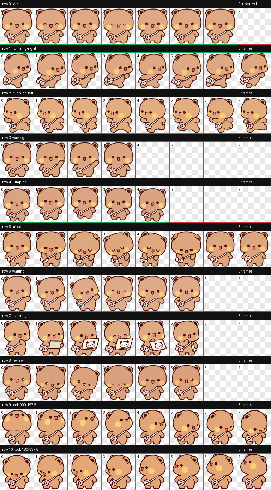

# 相机布布 · Codex 桌面宠物

斜挎粉色小相机的布布。思考时会拿出小电脑，电脑背面贴着一二 wink 大头照。

An unofficial Bubu companion for the Codex desktop app, with a crossbody camera and a Yier wink sticker on the laptop.

包含 9 组动作、16 个注视方向，透明 WebP 动作图集。此项目为非官方同人宠物，与黄小B、角色权利人及 OpenAI 无隶属或合作关系。

代码采用 MIT 许可；角色与美术素材的许可范围见[美术素材权利说明](https://github.com/Touyuanyuan/codex-bubu-pet/blob/main/ASSET-NOTICE.md)。

## Windows 安装（推荐）

**[下载 Windows 安装包](https://github.com/Touyuanyuan/codex-bubu-pet/releases/download/v1.0.0/codex-bubu-pet-v1.0.0-windows.zip)** · [版本发布页](https://github.com/Touyuanyuan/codex-bubu-pet/releases/tag/v1.0.0)

1. 下载发行包 `codex-bubu-pet-v1.0.0-windows.zip`，选择“全部解压”。
2. 打开解压后的文件夹，双击 **`install.cmd`**。不需要管理员权限、Python、Node.js 或联网。
3. 回到 Codex：**设置 → Mini 与虚拟宠物 → 点击“创建虚拟宠物”左侧的小刷新图标 ↻ → 相机布布**。

安装完成后仍需在 Codex 中刷新并选中一次。安装脚本不会修改当前选择，也不会重新创建宠物聊天。请不要直接在压缩包预览窗口里运行脚本。

安装目录默认为 `%USERPROFILE%\.codex\pets\bubu-camera`。如果设置了 `CODEX_HOME`，则安装到该目录下的 `pets\bubu-camera`。脚本只写入本宠物的目录，不需要关闭 Codex。

重复安装同一版本会提示已经安装。若同名目录已有不同文件，脚本会停止并保留现有内容，避免覆盖你的修改。需要换版本时，先把旧的 `bubu-camera` 文件夹移出 `pets` 目录留作备份，再安装。

## macOS 安装（候选版）

Mac 安装包复用 v1.0.0 的动画素材，无需重新制作布布。

1. 下载并解压 `codex-bubu-pet-v1.0.0-macos-preview.zip`。
2. 打开解压后的文件夹，双击 **`install.command`**，等待「相机布布安装完成」。
3. 回到 Codex：**设置 → Mini 与虚拟宠物（或 Pets）→ 小刷新图标 ↻ → 相机布布**。

不需要管理员权限、Python、Node.js 或 Homebrew。默认安装到 `~/.codex/pets/bubu-camera`，支持 `CODEX_HOME`。双击受系统限制时，可在终端输入 `/bin/bash ` 后拖入 `install.command` 再回车，或按文档手动复制。

完整步骤见 [Mac 安装说明](docs/INSTALL-MACOS.md)。候选包仍需 Mac 用户确认客户端内的实际显示；当前不将其标为已完成 Mac 桌面实机验证。

## 预览

双击 [preview.html](preview.html)，可离线查看所有动作、注视方向和深浅背景。

<details>
<summary>展开完整动作总览</summary>



</details>

## 官方安装链接

Codex 支持以 HTTPS 动作图集地址打开 `codex://pets/install` 安装流程。发布到公开 GitHub 仓库后，可以运行：

```powershell
powershell -NoProfile -ExecutionPolicy Bypass -File tools\make-install-link.ps1 -Repository "你的用户名/codex-bubu-pet"
```

它会生成 `install-link.txt`、`install-in-codex.url` 和 `install.html`，图集地址固定到 `v1.0.0` 标签。将这些文件随同发行包分享；也可把 `install.html` 发布为静态网页，提供“安装到 Codex”按钮。GitHub README 可能不允许直接点击自定义协议链接，因此仍提供离线安装包。

只有创建 `v1.0.0` 标签并推送含图集的提交后，该在线安装链接才有效。接收者的桌面客户端需要支持宠物 v2 和此协议；可能需要确认打开 Codex 并在应用中确认安装。

## 手动安装

将仓库中的 `pet` 文件夹复制到你的 Codex 用户目录下的 `pets` 中，重命名为 `bubu-camera`，保持下面结构：

```text
~/.codex/pets/bubu-camera/
  pet.json
  spritesheet.webp
```

再在设置中刷新并选中。Windows 安装脚本支持 `-CodexHome "D:\你的 Codex 目录"` 指定目录；Mac 可用 `bash install.sh "你的 Codex 目录"`。此包不用于 ChatGPT 网页端上传。

## 卸载

先在 Codex 中选择其他宠物或“无”，再删除本宠物的 `pets/bubu-camera` 文件夹，返回设置刷新。请仅删除这个文件夹。

## 兼容与验证

- 已在 Windows 的 Codex `26.1016.8622.0` 中识别，用户已确认列表中出现“相机布布”。
- 图集格式：v2，1536 × 2288 像素，8 列 × 11 行，每格 192 × 208 像素。
- 安装前核对图集 SHA-256；安装测试在独立临时目录运行，不影响正在使用的宠物。
- 原画参考仅保留链接和署名，不将原作者下载图片打包。宠物图集为参考角色形象后以 AI 辅助生成、整理的同人素材。

开发者可运行 `tests/test-install.ps1` 检查安装行为，用 Python 3.9+ 运行 `python tools/build-release.py` 构建发行包与校验文件。构建程序只打包固定清单，不包含本地会话、账户信息或研究文件。

Mac 包使用 `python3 tools/build-macos-release.py` 单独构建。Mac 安装行为测试为 `python3 -m unittest discover -s tests -p 'test_*macos.py' -v`，并配置了 macOS GitHub Actions。打包时保留脚本执行权限与 LF 换行；Windows 发行包与脚本保持不变。

## 许可与来源

- [MIT 代码许可](LICENSE)
- [美术素材权利说明](ASSET-NOTICE.md)
- [原作者与参考来源](CREDITS.md)
- [Codex 官方宠物说明](https://learn.chatgpt.com/docs/pets)
- [官方安装协议参数](https://learn.chatgpt.com/docs/reference/commands#pets)
